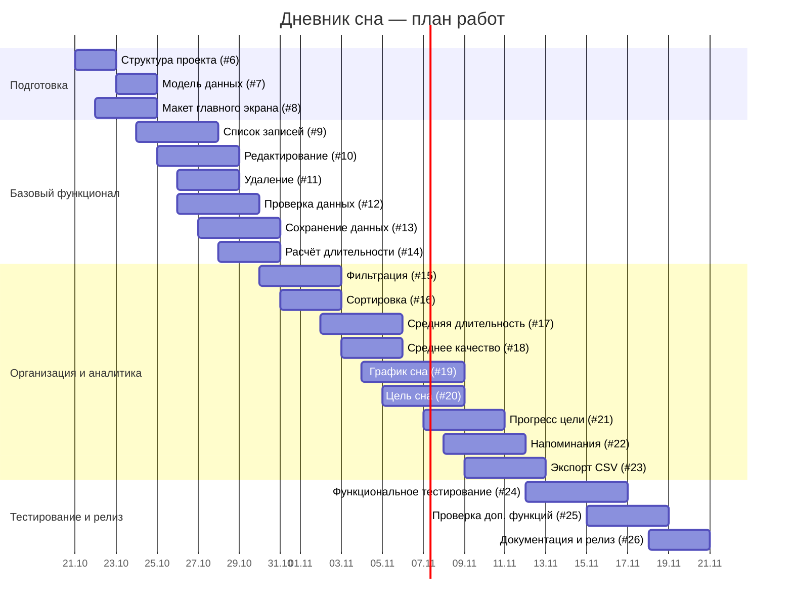

# Диаграмма Ганта — «Дневник сна»

Плановый период: 21.10.2026–20.11.2026. Диаграмма отображает последовательность работ и основные зависимости. Даты являются плановыми.

## Этапы (предлагаемые Milestones)

| Milestone | Срок | Критерий завершения |
|---|---|---|
| Подготовка и настройка | 24.10.2026 | Структура, модель данных и макет готовы |
| Базовый функционал | 30.10.2026 | Создание, просмотр, редактирование, удаление и сохранение записей работают |
| Организация и аналитика | 12.11.2026 | Фильтры, статистика, график, цели, напоминания и CSV готовы |
| Тестирование и релиз | 20.11.2026 | Тесты пройдены, документация подготовлена, версия 1.0 готова |

## Что такое Milestones в GitHub?

Milestone — это контрольная точка/этап, к которому привязывают несколько Issues. У этапа есть название, описание и срок завершения; GitHub показывает, сколько задач этапа закрыто и сколько осталось. Это не то же самое, что диаграмма Ганта: Milestone группирует работу вокруг результата и срока, а диаграмма показывает календарное расположение задач.

## Важно

Этот файл — диаграмма для репозитория, но не интерактивный GitHub Projects Roadmap. Для полноценного Roadmap нужно создать GitHub Project, добавить туда Issues и настроить поля дат начала/завершения. Milestones нужно создать отдельно в разделе Issues → Milestones и затем назначить соответствующим задачам.
